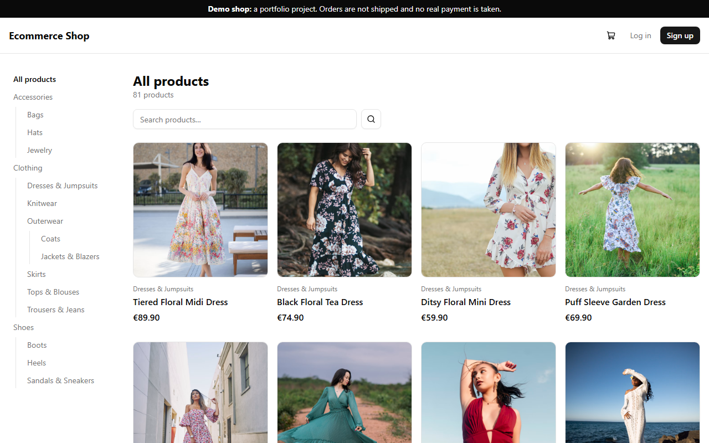
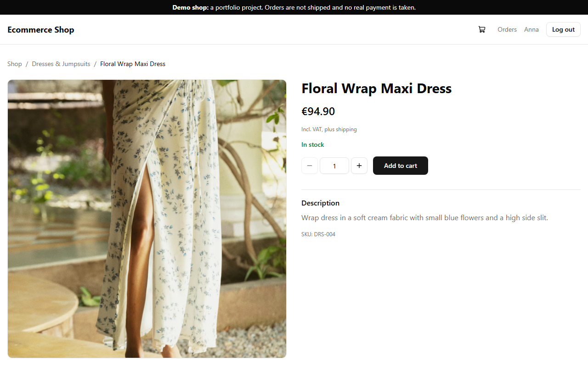
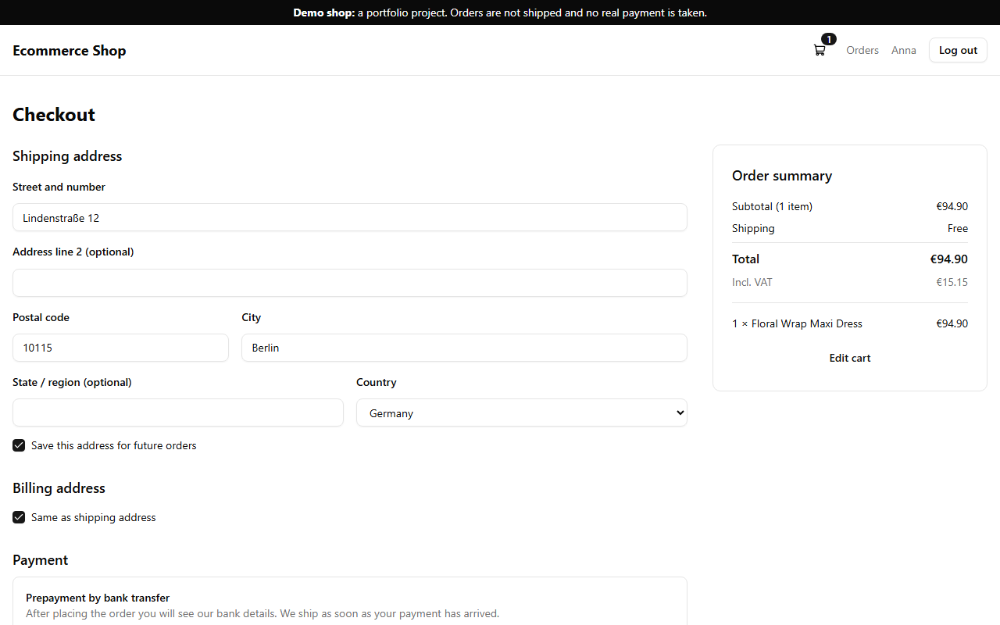
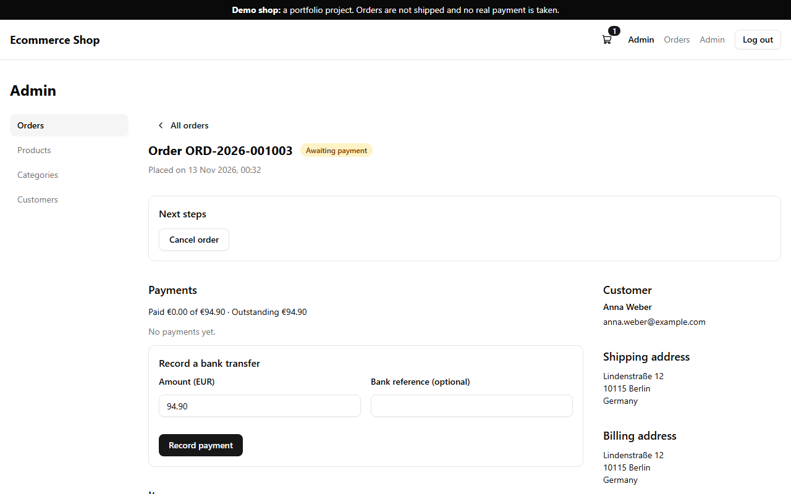
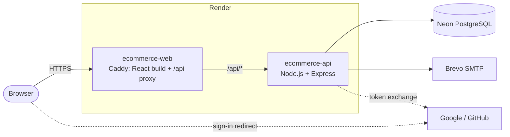

# Ecommerce


A full-stack online shop (women's fashion), built step by step like a real company project: feature branches, pull requests, CI/CD, automated tests at every level and a production deployment.

**Live demo: https://ecommerce-web-p2p5.onrender.com**

> This is a demo shop and portfolio project, not a real store. Nothing is shipped and the bank details are examples. It runs on free hosting, so the first visit after a quiet period can take about a minute while the services wake up.



| Product page | Checkout | Admin: order |
| --- | --- | --- |
|  |  |  |

## Features

**Customers**

- Browse 80+ products in 17 nested categories, full-text search, filters and pagination kept in the URL
- Cart and one-page checkout with saved addresses; prepayment by bank transfer with the order number as reference
- Order history with status, outstanding amount and payment details
- Account: profile, address book, change password, logged-in devices (log out one or all), GDPR account deletion
- Sign up with email (verification link) or with Google / GitHub, password reset by email

**Admins**

- Orders: search, status changes following a state machine, record (partial) payments, internal notes and history
- Products: create and edit, images by URL, stock movements as an append-only ledger, inventory counts
- Categories as a tree (move, nest up to 3 levels), customers with order statistics and support deletion

**Under the hood**

- Auth with short-lived access tokens and rotating single-use refresh tokens in httpOnly cookies; refresh token reuse revokes the session
- Money as integer cents, VAT and shipping calculated on the server, stock and order changes in transactions
- Rate limiting, CORS allowlist, security headers and a Content Security Policy, parameterized SQL only
- Structured JSON logs with request IDs, liveness and readiness health checks
- Accessibility: every important page is scanned with axe (WCAG 2.1 AA) in the end-to-end tests, with zero violations

## Tech stack

| Area | Tools |
| --- | --- |
| Frontend | React 19, TypeScript, Vite, React Router, TanStack Query, React Hook Form + Zod, Tailwind CSS, shadcn/ui |
| Backend | Node.js 24, Express 5, PostgreSQL (`pg`, raw SQL), Zod, JWT, openid-client (OAuth), Nodemailer, pino |
| Testing | Jest + Supertest (API against a real database), Vitest + React Testing Library, Playwright + axe (end to end) |
| DevOps | Docker (multi-stage, non-root), Caddy, GitHub Actions, Trivy image scanning, GitHub Container Registry, Render, Neon |

## Architecture



- **Same origin:** the browser only talks to the web service. Caddy serves the React app and forwards `/api/*` to the API, so the auth cookies can be `SameSite=Strict`.
- **API layers:** every feature module (`Server/src/modules/<feature>/`) has routes → controller → service → repository. Business rules live in the service, SQL only in the repository.
- **Frontend features:** `Client/src/features/<feature>/` holds the API calls, TanStack Query hooks, form schemas and components of one area.

### Delivery pipeline

Every pull request runs: lint and formatting (server and client), type check, unit and integration tests, end-to-end tests with a real database and mail server, and a smoke test of the production Docker images. On `main`, the images are scanned with Trivy, pushed to GHCR and deployed to Render; the pipeline waits until the new commit answers on the live site.

## Project structure

| Folder | Description |
| --- | --- |
| [`Server/`](Server/) | REST API ([details](Server/README.md)), API docs at `/api/docs` (Swagger) |
| [`Client/`](Client/) | React single-page app |
| [`e2e/`](e2e/) | Playwright end-to-end and accessibility tests |
| [`.github/workflows/`](.github/workflows/) | CI/CD pipeline |
| `docker-compose.yml` | Local services: PostgreSQL and Mailpit |
| `docker-compose.prod.yml` | The whole shop from the production images |
| `render.yaml` | Production infrastructure as code (Render Blueprint) |

## Getting started

Requirements: Node.js 24 (see [`.nvmrc`](.nvmrc), run `nvm use`), Docker (or a local PostgreSQL instance).

```bash
docker compose up -d   # PostgreSQL on localhost:5433 and Mailpit
cd Server
cp .env.example .env   # then adjust the values
npm install
npm run db:migrate     # creates the database and runs all pending migrations
npm run db:seed        # sample categories, products and an admin user
npm run dev            # API on http://localhost:5000, docs on /api/docs
```

Frontend, in a second terminal (the API must be running):

```bash
cd Client
npm install
npm run dev            # shop on http://localhost:3000
```

- Vite proxies `/api` to `http://localhost:5000` (override with `VITE_API_PROXY_TARGET`), the same origin setup as in production.
- Emails (verification, password reset) are caught by Mailpit at http://localhost:8025. Nothing reaches real inboxes.
- Admin login after seeding: `SEED_ADMIN_EMAIL` / `SEED_ADMIN_PASSWORD` from `Server/.env` (default `admin@example.com` / `admin12345`).
- Without Docker: point `PGPORT` in `Server/.env` to your local PostgreSQL (usually `5432`).

The whole shop from the production images instead:

```bash
cp .env.example .env   # set JWT_SECRET
docker compose -f docker-compose.prod.yml up --build -d   # http://localhost:8080
```

## Database

Schema changes are versioned SQL files in [`Server/src/db/migrations/`](Server/src/db/migrations/) ([node-pg-migrate](https://salsita.github.io/node-pg-migrate/)). A merged migration is never edited; changes get a new one, and every migration has a working down section.

```bash
npm run db:migration:create add-wishlist   # new SQL migration
npm run db:migrate                         # apply pending migrations
npm run db:rollback                        # revert the last one
npm run db:reset                           # development only: drop everything, migrate and seed
```

`npm run db:seed` is idempotent (existing rows are skipped) and refuses to run in production. Product photos are from [Unsplash](https://unsplash.com) (free license); the photographers are credited in [`Server/src/db/seeders/data.js`](Server/src/db/seeders/data.js).

## Tests

```bash
cd Server && npm test   # Jest: unit tests + integration tests against the database ecommerce_db_test
cd Client && npm test   # Vitest + React Testing Library
cd e2e && npm test      # Playwright: user journeys and axe scans (first time: npx playwright install chromium)
```

- Server integration tests send real HTTP requests to the API and use their own database, which is emptied before each test.
- End-to-end tests start their own copy of the app (API on port 5100, client on 3100, database `ecommerce_db_e2e`), so the dev servers are never touched. They need PostgreSQL and Mailpit from docker compose.

## Contributing

See [CONTRIBUTING.md](CONTRIBUTING.md): branches, Conventional Commits and the pull request flow.
